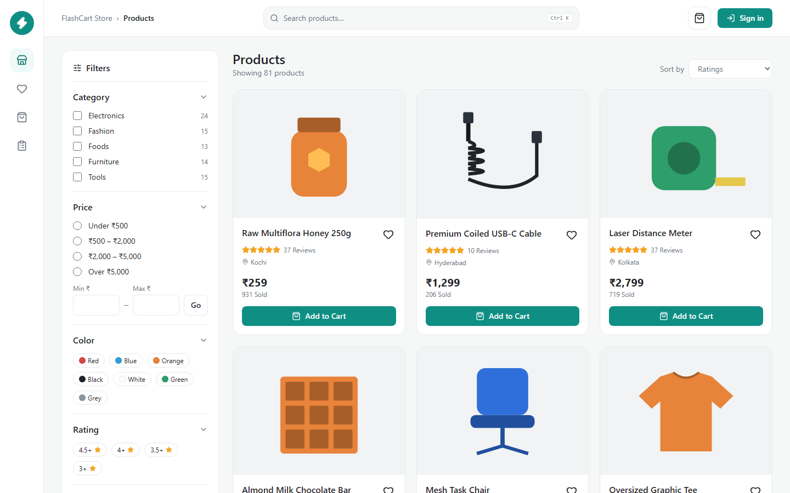

# FlashCart + CloudOps Sentinel

A real, multi-user e-commerce app (**FlashCart**) plus a monitoring & security dashboard (**CloudOps Sentinel**),
built end-to-end as a DevOps / SRE / cloud portfolio project on a **₹0 budget** using free-tier services.

| | |
|---|---|
| **Frontend** | React 19 + Vite + TypeScript + Tailwind CSS |
| **Backend** | Python FastAPI (async) |
| **Database** | MongoDB Atlas M0 (hosted) · portable MongoDB 8.0 replica set (local dev/tests) |
| **Planned hosting** | AWS Lambda (Function URL) + S3 + CloudFront, via Terraform + GitHub OIDC |
| **DevOps** | GitHub Actions, Docker, kind/Kubernetes, Helm, Trivy, Gitleaks, k6, Playwright |
| **Observability** | Structured JSON logs, Prometheus metrics, Grafana, OpenTelemetry, CloudWatch |

---

## 📍 Where the project is right now

> **Current level: Phase 3 of 11 complete — FlashCart works end-to-end locally (frontend + backend).**
> Next: CI/CD pipeline (Phase 5) and the remaining planning documents (Phase 2). Atlas (Phase 4) waits on the owner.

```
Overall progress  [██████████████░░░░░░░░░░░░░░░░]  ~45%
```

**Legend:** ✅ done & verified · 🟡 in progress · ⬜ not started · ⛔ blocked (needs owner action)

| # | Phase | Status | Notes |
|---|---|:---:|---|
| 1 | Inspect environment, tools, references, free-tier limits | ✅ | Tools installed on D: with checksums; 40-page PDF inventoried; Atlas/AWS limits checked on official pages |
| 2 | PRD, scope, architecture, data model, API spec, threat model, cost analysis | 🟡 | 5 of 21 docs done (status, decisions, troubleshooting, installation log, changelog) |
| 3 | Build FlashCart (frontend + backend) locally | ✅ | Backend ✅ · Frontend ✅ — storefront, cart, checkout, orders, auth, admin, responsive |
| 4 | MongoDB Atlas integration | ⬜ | Needs owner to create the Atlas M0 cluster (local MongoDB used until then) |
| 5 | Automated tests, GitHub Actions, Docker, security scans | ✅ | CI green · Docker images (0 fixable HIGH/CRITICAL) · kind + Prometheus/Grafana |
| 6 | Controlled load testing (k6) | ⬜ | k6 installed; tests not written |
| 7 | Terraform + free-tier deployment config | 🟡 | Lambda + S3 + CloudFront + budget + OIDC written and validated; `plan` needs AWS |
| 8 | Deploy FlashCart (after approval) | ⬜ | Needs AWS account + owner approval of the exact resource list |
| 9 | Build CloudOps Sentinel and connect to FlashCart | ⬜ | Backend already exposes `/api/v1/health`, `/metrics`, audit log for it |
| 10 | Failure simulations, incident reports, postmortems | ⬜ | |
| 11 | Final security review, cost review, cleanup, docs | ⬜ | |

Detailed checklist: **[docs/PROJECT-STATUS.md](docs/PROJECT-STATUS.md)**

---

## ✅ What already works (verified)



**FlashCart web** (`apps/flashcart-web`) — [more screenshots](docs/screenshots/)
- Storefront modelled on the reference layout: icon rail, breadcrumb, search (Ctrl K), filter sidebar
  (category, price, colour, rating, shipping, stock), sortable paginated grid, favorites, add to cart
- Product details, guest cart that follows you into your account, checkout, order confirmation, order history
- Admin dashboard: revenue/orders/low-stock, add products, edit prices (conflict-safe), adjust stock, manage orders
- Mobile layout with bottom navigation and filter drawer; keyboard accessible (skip link, focus styles, ARIA)

**FlashCart API** (`apps/flashcart-api`)
- Product catalog: text search, category/price/colour/rating/shipping filters, 5 sort orders, pagination
- Cart (server-priced), favorites, guest-cart merge after login
- Checkout as one ACID transaction — **no overselling** under concurrent buyers
- **Idempotency keys** — double-clicks / retries create exactly one order
- Order history (users only ever see their own orders)
- Admin: product CRUD with optimistic locking, audited stock changes, order status state machine
  (cancelling restores stock), stats, audit log
- Signed payment webhooks (HMAC + timestamp tolerance + replay protection)
- Auth: Argon2id passwords, short-lived JWTs with key rotation, rotating refresh tokens with
  stolen-token detection, CSRF protection, rate-limited login/signup
- Health (`/healthz`, `/readyz`, `/api/v1/health`), Prometheus `/metrics`, JSON logs with request IDs
  and secret redaction, security headers, body-size limits, timeouts

**Latest verification results**

| Check | Result |
|---|---|
| Backend tests (pytest) | **78 passed, 0 failed** — incl. 20-buyer race and 10× duplicate-submit tests (5/5 repeat runs green) |
| Frontend unit/component tests (Vitest) | **22 passed** — incl. a proven regression test for the cart-merge bug |
| End-to-end tests (Playwright, desktop + mobile) | **8 passed** — 5/5 consecutive green runs |
| TypeScript / ESLint / production build | passed · main bundle 110 kB gzipped |
| npm audit | 0 vulnerabilities (2 high in dev deps fixed via overrides) |
| Supply-chain age check | 296 npm packages ≥14 days old (2 documented security-fix exceptions) |
| Lint (ruff) | passed |
| Static analysis (bandit) | 0 issues (5 false positives triaged and annotated) |
| Dependency CVEs (pip-audit) | 0 known vulnerabilities |
| Secret scan (gitleaks) on committed files | no leaks |
| GitHub | secret scanning + push protection + Dependabot alerts enabled |

---

## 🚀 Run it locally (Windows / PowerShell)

Prerequisites: Git, Python 3.13, [uv](https://docs.astral.sh/uv/). Everything else is downloaded into the
project folder (no admin rights needed).

```powershell
# 1. Download pinned, checksum-verified tools (MongoDB, Terraform, Trivy, Gitleaks, k6, kind, Helm, kubectl)
.\scripts\setup\install-tools.ps1
. .\scripts\setup\env.ps1                      # use them in this shell; caches stay on D:

# 2. Start local MongoDB (single-node replica set, needed for transactions)
.\scripts\dev\start-mongo.ps1

# 3. Backend
cd apps\flashcart-api
copy .env.example .env                         # then replace the <generate...> placeholders
uv sync
uv run python -m app.seed                      # load the 80-product demo catalog
uv run uvicorn app.asgi:app --port 8000        # API docs: http://127.0.0.1:8000/api/docs

# 4. Frontend (new terminal, from the repo root)
cd apps\flashcart-web
npm ci
npm run dev                                    # http://127.0.0.1:5173 (proxies /api to :8000)

# 5. Tests and checks
cd apps\flashcart-api; uv run pytest -q; uv run ruff check app tests; uv run bandit -r app -c pyproject.toml
cd apps\flashcart-web; npm run typecheck; npm run lint; npm test
$env:PLAYWRIGHT_BROWSERS_PATH="$PWD\..\..\.cache\ms-playwright"; npx playwright install chromium; npm run e2e
```

> Demo admin: set `FLASHCART_ADMIN_EMAIL` / `FLASHCART_ADMIN_PASSWORD` in your local `.env` before first start.

---

## 📁 Repository layout

```
apps/
  flashcart-api/        FastAPI backend (done)
  flashcart-web/        React storefront + admin (done) — e2e tests in e2e/
docs/                   Status, decisions, troubleshooting, installation log, changelog, screenshots
references/             PDF-INVENTORY.md (the PDF/screenshot themselves stay local — copyrighted)
scripts/setup/          Tool installer + shell environment
scripts/dev/            Start/stop local MongoDB
scripts/ci/             Supply-chain (package age) checks
CLAUDE.md               Rules and conventions for working on this repo
```

## 🔒 Security & budget rules

- No secrets in git — only `.env.example` with placeholders is committed; real `.env` files are gitignored.
- ₹0 budget: nothing billable is created without explicit approval of the exact resources.
- Only tool/package versions at least 14 days old, with checksums verified.
- No system ever "has zero vulnerabilities" — findings and their fixes are documented, not hidden.

## Credits

Product images are original SVG illustrations generated by `apps/flashcart-api/app/seed_data.py`.
The storefront layout is inspired by a reference screenshot; no third-party branding or assets are used.
